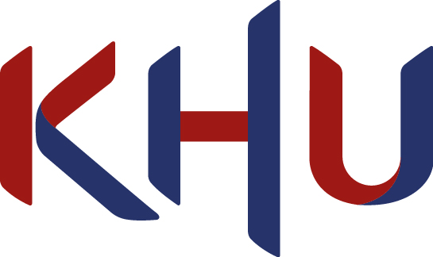

  

<picture>
  <source media="(prefers-color-scheme: dark)" srcset="assets/khu_dark.png">
  
</picture>
&nbsp;&nbsp;&nbsp;&nbsp;&nbsp;&nbsp;

<b>Kyung Hee University</b> &nbsp;·&nbsp; <b>Neumous</b>

  

 

 

## 👋 About Me

- 🔭 Developing **simulation and planning tools** for transcranial focused ultrasound
- 🧪 Connecting **acoustic simulation, machine learning and image-guided navigation** for safer ultrasound therapy
- 💬 Ask me about **acoustic simulation, ultrasound transducers and ultrasound through the skull**

 

## 🔬 Research Interests

<table align="center">
<tr>
<td align="center" width="200"> <b>Focused Ultrasound</b></td>
<td align="center" width="200"> <b>Transcranial Ultrasound</b></td>
<td align="center" width="200"> <b>Transducer Design</b></td>
</tr>
<tr>
<td align="center"> <b>BBB Opening</b></td>
<td align="center"> <b>Brain Hyperthermia</b></td>
<td align="center"> <b>Navigation System</b></td>
</tr>
</table>

 

## 🎓 Education

| | | |
|:---:|---|---|
|  | **M.S.**, Kyung Hee University Integrated B.S.–M.S. program · <a href="https://migt.khu.ac.kr/">MIGT Lab</a> | `Sep 2026 – Feb 2028 (expected)` |
|  | **B.S.**, Kyung Hee University | `Mar 2021 – Aug 2026` |

## 💼 Experience

| | | |
|:---:|---|---|
|  | **Industry–Academic Researcher**, Neumous | `Sep 2026 – Present` |
|  | **Research Intern**, Neumous | `Sep 2025 – Aug 2026` |

 

## 🛠️ Tech Stack

  

 

## 🐍 Contributions

<picture>
  <source media="(prefers-color-scheme: dark)" srcset="https://raw.githubusercontent.com/Geunho-Shim/Geunho-Shim/output/github-snake-dark.svg" />
  
</picture>

